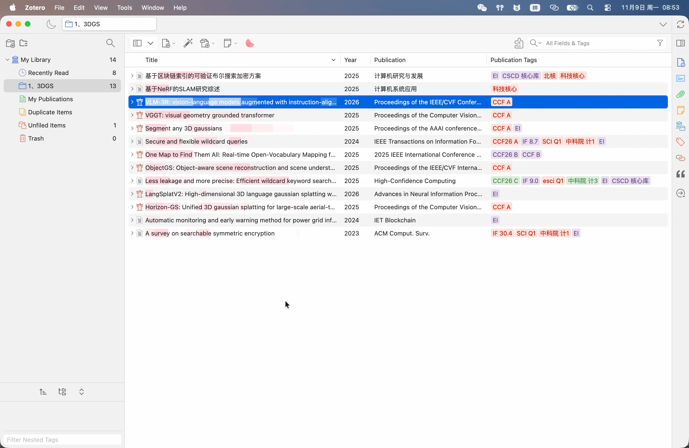
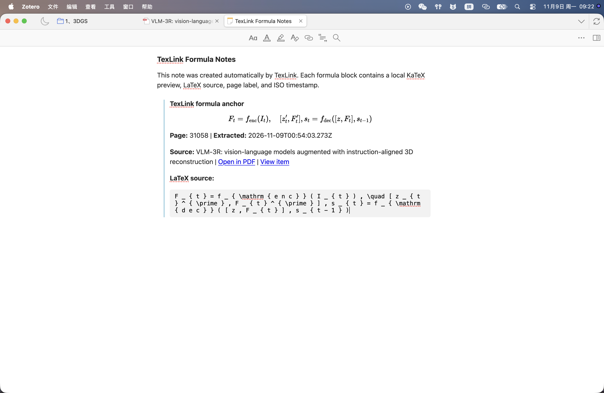

# TexLink

### Turn formula screenshots into durable Zotero notes.

🌐 **English** · [简体中文](README.zh-CN.md)

`✅ Zotero`  ·  `🔒 Fully offline`  ·  `📝 Notes-first`  ·  `⚡ One click`

TexLink is a small Zotero add-on for one job: keep the formulas you find while
reading. Select a formula in a PDF, run TexLink, and get a clean formula block
inside the literature note — with the page, time, source, and preview together.

---

## ✨ What TexLink does

- 📌 **Starts from your PDF.** Use Zotero's native image annotation tool to
  select a formula.
- 📝 **Writes to your note.** The result goes into the note for that paper, not
  into a clipboard or a separate app.
- 🔗 **Keeps the context.** Page, extraction time, source link, and an optional
  comment stay with the formula.
- 🔍 **Stays searchable.** The rendered formula and its source are both in the
  note.

## 🚀 How it works

1. **Select** a formula with the **Region Image** tool.
2. **Right-click** the selection and choose **TexLink**.
3. **Done.** The formula block appears in your note.

  

You can also start TexLink from the Tools menu.

## 📝 What you get

  

Every formula block includes:

- 🧮 a rendered formula preview
- 📄 the page label and extraction time
- 🔗 links back to the PDF and the source item
- ✍️ an optional comment
- 🔎 the searchable formula source

## 🎯 Why TexLink

| | TexLink | Typical screenshot tool |
|---|:---:|---|
| 📌 Source | Native Zotero image annotation | Screenshot or clipboard |
| 📝 Destination | Zotero literature note | A separate document or app |
| 🔗 Context | Page, time, and source links | Usually lost |
| 🔒 Recognition | Fully offline | Often online |
| 🧮 Preview | Rendered in the note | Plain text |
| 🔍 Search | Formula source is searchable | Depends on paste target |

## ⚙️ Settings

Open **Zotero Settings → TexLink** to choose where formulas are written, change
the shortcut, or turn on an optional comment prompt.

The TexLink interface follows Zotero's global language setting. There is no
separate language switch inside the add-on.

## 📦 Install

1. Open the [latest release](https://github.com/yuweidong/zotero-texlink/releases).
2. Download the `.xpi` file.
3. In Zotero, open **Tools → Add-ons → gear menu → Install Add-on From File…**
4. Select the XPI, restart Zotero, and open **Settings → TexLink**.

## 🌍 Language

- English: this page
- 简体中文: [中文说明](README.zh-CN.md)

Both versions follow Zotero's global locale automatically.

## 💡 Good to know

- TexLink is made for **formula images**, not full-page text or tables.
- A clearer screenshot gives a better result.
- The PDF should be attached to a regular Zotero item.
- TexLink keeps formulas local and never replaces them with a guessed result.

## 📄 License

MIT. See [LICENSE](LICENSE) and [THIRD_PARTY_NOTICES.md](THIRD_PARTY_NOTICES.md).
