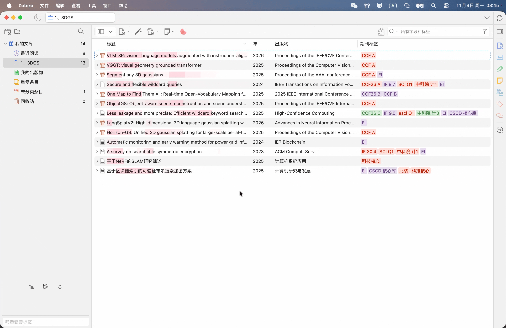
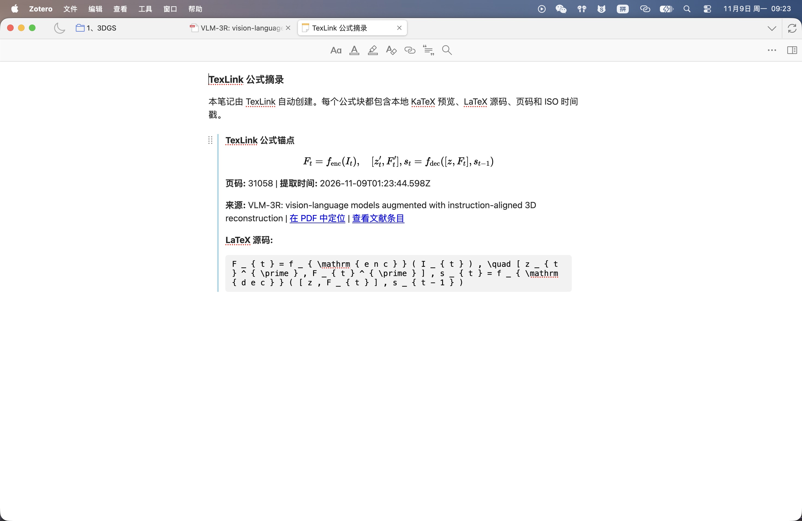

# TexLink

### 把公式截图变成可长期保存的 Zotero 笔记。

🌐 [English](README.md) · **简体中文**

`✅ Zotero`  ·  `🔒 完全离线`  ·  `📝 笔记优先`  ·  `⚡ 一键完成`

TexLink 是一个专注的小型 Zotero 插件：把阅读时遇到的公式留在笔记里。
在 PDF 中框选公式，运行 TexLink，公式块就会出现在文献笔记中，并同时保留页码、时间、来源和公式预览。

---

## ✨ TexLink 能做什么

- 📌 **从 PDF 开始。** 使用 Zotero 原生的图像注释工具框选公式。
- 📝 **写入你的笔记。** 结果进入这篇文献的 Zotero 笔记，而不是剪贴板或另一个应用。
- 🔗 **保留上下文。** 页码、提取时间、来源链接和可选备注都与公式放在一起。
- 🔍 **随时可搜索。** 渲染后的公式和公式源码都保存在笔记中。

## 🚀 怎么用

1. **框选**：用**区域图像**工具选中公式。
2. **右键**：在右键菜单中选择 **TexLink**。
3. **完成**：公式块自动出现在笔记中。

  

也可以从工具菜单启动 TexLink。

## 📝 你会得到什么

  

每个公式块都包含：

- 🧮 渲染后的公式预览
- 📄 页码和提取时间
- 🔗 返回 PDF 和文献条目的链接
- ✍️ 可选备注
- 🔎 可搜索的公式源码

## 🎯 TexLink 的区别

| | TexLink | 普通截图工具 |
|---|:---:|---|
| 📌 输入 | Zotero 原生图像注释 | 截图或剪贴板 |
| 📝 输出去向 | Zotero 文献笔记 | 独立文档或应用 |
| 🔗 上下文 | 页码、时间、来源链接 | 通常会丢失 |
| 🔒 识别方式 | 完全离线 | 通常需要联网 |
| 🧮 公式预览 | 在笔记中直接渲染 | 纯文本 |
| 🔍 搜索 | 公式源码可搜索 | 取决于粘贴位置 |

## ⚙️ 设置

打开 **Zotero 设置 → TexLink**，可以选择公式写入位置、修改快捷键，或开启可选的备注输入。

TexLink 的界面语言跟随 Zotero 的全局语言设置。插件内部没有单独的语言开关。

## 📦 安装

1. 打开 [最新版本](https://github.com/yuweidong/zotero-texlink/releases)。
2. 下载 `.xpi` 文件。
3. 在 Zotero 中打开 **工具 → 插件 → 齿轮菜单 → 从文件安装插件…**
4. 选择 XPI，重启 Zotero，然后打开 **设置 → TexLink**。

## 🌍 语言

- 简体中文：当前页面
- English: [English README](README.md)

两个版本都会自动跟随 Zotero 的全局语言。

## 💡 使用提示

- TexLink 面向**公式图片**，不处理整页文字或表格。
- 截图越清晰，识别效果越好。
- PDF 应当作为附件挂在正式文献条目下。
- TexLink 保持本地处理，不会用猜测结果替换公式。

## 📄 许可证

MIT。参见 [LICENSE](LICENSE) 和 [THIRD_PARTY_NOTICES.md](THIRD_PARTY_NOTICES.md)。
